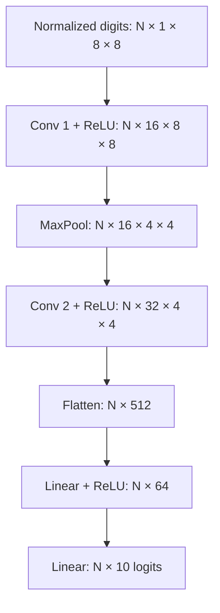

# ForgeCNN architecture

Original PyTorch network, random Kaiming-normal initialization and zero biases. Input is a batch of normalized UCI 8x8 grayscale digits. Logits feed cross-entropy during training; softmax is only for demonstration output. No pretrained weights.

| Stage | Operator | Output tensor | Trainable parameters | MACs / image |
|---|---|---|---:|---:|
| Input | train-fitted normalization | N × 1 × 8 × 8 | 0 | 0 |
| Conv 1 | 3×3, stride 1, padding 1, 1 to 16 + ReLU | N × 16 × 8 × 8 | 160 | 9,216 |
| Pool | MaxPool 2×2, stride 2 | N × 16 × 4 × 4 | 0 | 0 |
| Conv 2 | 3×3, stride 1, padding 1, 16 to 32 + ReLU | N × 32 × 4 × 4 | 4,640 | 73,728 |
| Flatten | contiguous feature vector | N × 512 | 0 | 0 |
| FC 1 | Linear 512 to 64 + ReLU | N × 64 | 32,832 | 32,768 |
| Head | Linear 64 to 10 | N × 10 | 650 | 640 |
| Total | | N × 10 | **38,282** | **116,352** |

One multiply and one add count as two floating-point operations, giving 232,704 arithmetic FLOPs/image for convolution and linear MACs alone. This estimate excludes pooling, activations, bias, layout transforms and quantization overhead. FP32 parameter payload is 153,128 bytes, excluding metadata.

Two convolutions capture local structure and spatial feature combinations. One early pooling layer reduces Conv 2 cost by 4× relative to operating at 8x8. A fully connected layer keeps spatial detail for digits but owns 85.8% of the parameters. Replacing it with global average pooling could reduce weights but discard positional information. That is an untested architecture experiment, not an improvement claim.

Static INT8 fuses Conv/ReLU and Linear/ReLU pairs. QuantStub converts incoming FP32 activations to quantized values; DeQuantStub returns FP32 logits. Weights use the x86 backend's per-channel configuration. Input/output and some operations still involve FP32 or conversion overhead. An INT8 checkpoint is therefore not assumed to be exactly one-quarter of FP32 file size.

Channels-last changes the tensor's storage layout while retaining NCHW logical shape. With a single input channel, some input strides can be ambiguous; internal feature maps still have multiple channels. Flattening channels-last features may require a copy. Benchmark the complete forward path rather than just an individual convolution.
