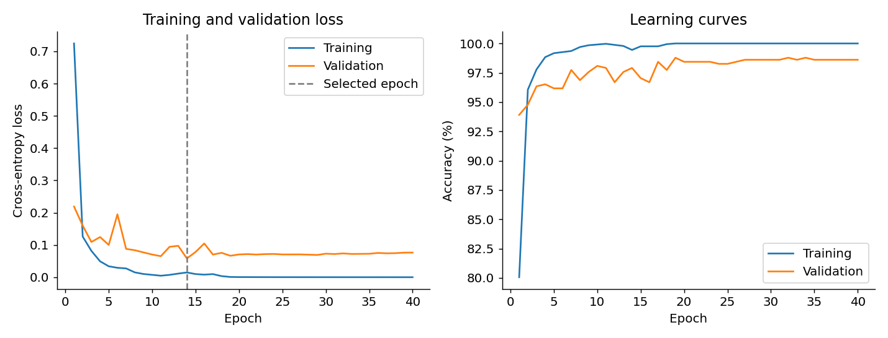
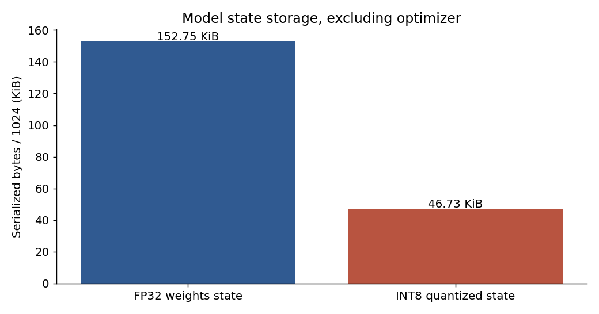
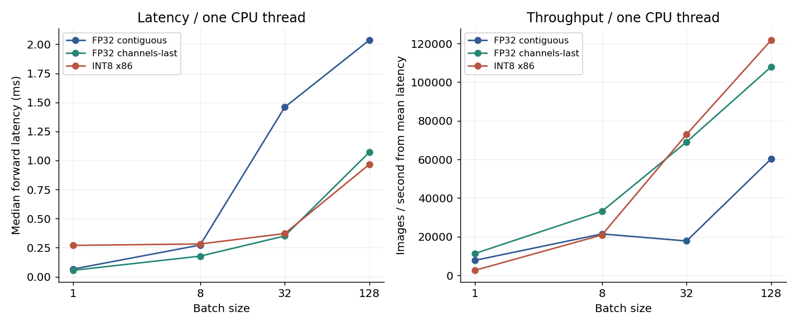
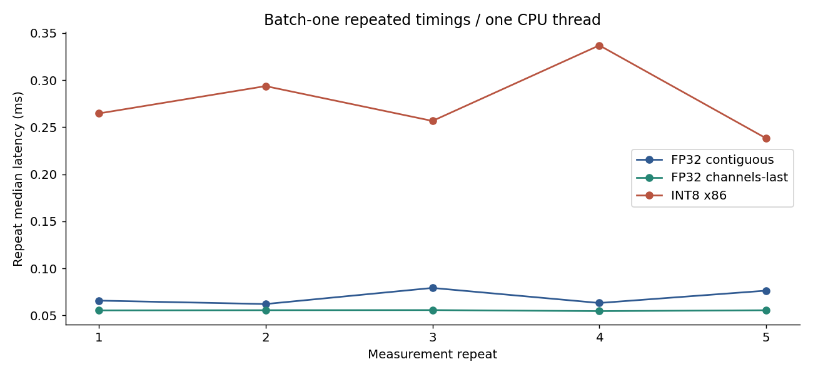
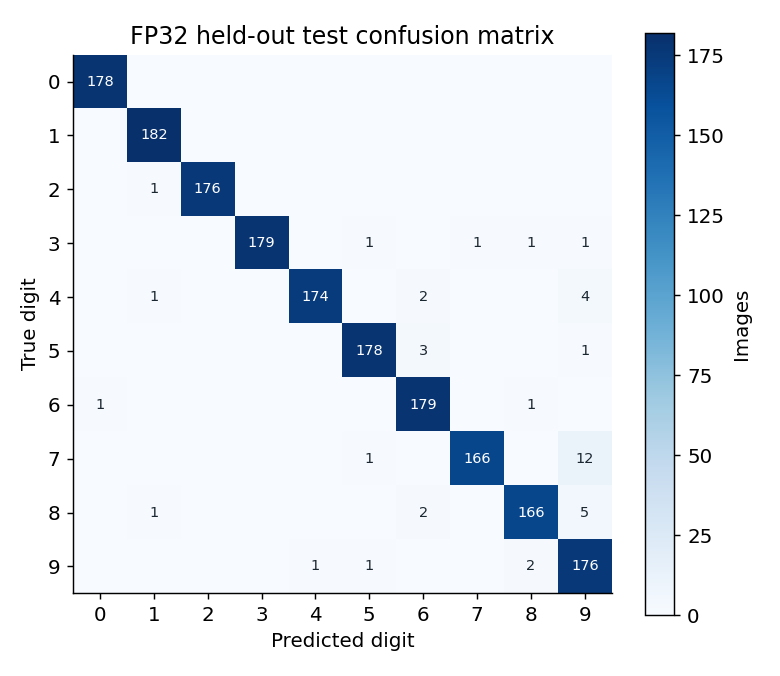

# ANNA Neural Intelligence — engineering report

Anna Nexus Labs LLC • Christopher Payne • Operation Neural Forge • 13 October 2026

## Verified outcome

An original 38,282-parameter PyTorch CNN trained from random initialization on UCI Optical Digits. The predefined seed-369 reference correctly classifies 1754/1797 held-out images (**97.61% accuracy**). Its best validation-loss checkpoint is epoch 14 of 40. Automated neural tests pass 29/29. Repeating the reference seed produces bit-identical selected weights and identical test metrics in the same environment. ANNA 1.3 separately reproduces 101/101 tests plus strict TypeScript in an isolated copy.

This is an independent portfolio demonstration for technical discussion, not an official Tesla assignment or endorsed product. No custom Tesla silicon, GPU inference, live model API requests or production changes occurred. The owner approved publication. Source is public at https://github.com/Christopher4U1978/anna-neural-intelligence and the evidence page is live at https://behindtheveil369.work/anna-neural.

## Data and training

Original official split: 3,823 training-file examples and 1,797 test-file examples. Training-file split: 3,249 training / 574 stratified validation. Mean/std fit only training rows; INT8 calibration uses the first 512 training rows. Data and split manifests are retained. Train-only mean=0.30757001, std=0.37718487 after dividing pixels by 16. Exact-image overlap across official files: 0.

Fixed configuration: 40 epochs, batch 64, AdamW learning rate 0.002, weight decay 0.0001, two CPU intra-op threads, cross-entropy, no augmentation or pretrained network. Choose checkpoints only by validation loss. Training data ordering and initialization use fixed seeds. The test file was never used for training, normalization, observer calibration, early stopping or reference-model selection.

| Training seed | Selected epoch | Validation accuracy | Test accuracy | Test loss | Training wall time |
|---|---:|---:|---:|---:|---:|
| 369 | 14 | 97.91% | 97.61% | 0.08621 | 15.88 s |
| 370 | 13 | 98.08% | 97.33% | 0.09049 | 20.75 s |
| 371 | 11 | 98.78% | 97.38% | 0.10204 | 21.76 s |

Three-seed test accuracy: mean 97.44%, sample standard deviation 0.147 percentage points. These share one test set and are not independent estimates of population generalization. Seed 369 was predefined, not selected from this table. Training wall time includes validation and checkpoint saves, excludes setup/download and final held-out evaluation.

Reference test binomial Wilson 95% interval: 96.79%–98.22%. This interval does not address domain shift, correlated samples or model-selection uncertainty.

## Hardware and software

INTEL(R) XEON(R) PLATINUM 8573C, Linux x86_64 shared container, nine visible logical CPUs, cgroup CPU quota eight cores, memory limit 8 GiB. Python 3.12, PyTorch 2.5.1+cpu, NumPy 2.2.6, scikit-learn 1.8.0. No CUDA device. Full build configuration and package versions live in results/seed369/environment.json and requirements-cpu.lock.txt. Benchmark workers use one inter-op thread; intra-op count is recorded per row.

## Precision and storage tradeoffs

| Variant | Held-out accuracy | Held-out loss | Serialized model state |
|---|---:|---:|---:|
| FP32 | 97.61% | 0.08621 | 156,412 bytes |
| FP32 channels-last | 97.61% | 0.08621 | Same logical weights as FP32 |
| INT8 x86 | 96.72% | 0.11790 | 47,854 bytes |

INT8 accuracy changes by -0.890 percentage points (16 fewer correct classifications). Serialized state is 3.27× smaller, a 69.4% reduction. This comparison excludes optimizer state, Python/runtime and activation memory. The training checkpoint is 479,754 bytes. Quantized Conv/Linear weights are genuine qint8, validated in tests. Calibration, conversion, serialization/reload and full held-out inference executed successfully.

## Complete CPU benchmark matrix

Preallocated identical seeded inputs. Forward-only wall-clock CPU scope, 30 warmups, five repeats × 100 timed calls per condition. Mean, median, p95 and repeated variability are distinct. Throughput uses mean latency. Variant order interleaves within every condition. Individual JSON files contain every sample and environment. No concurrent model training or website build ran during the final matrix. The shared host may still contend.

| Variant | Batch | Threads | Median ms | Mean ms | p95 ms | Images/s | Repeat median CV | Peak process RSS MiB |
|---|---:|---:|---:|---:|---:|---:|---:|---:|
| FP32 contiguous | 1 | 1 | 0.0660 | 0.1288 | 0.3932 | 7,764 | 0.114 | 296.3 |
| INT8 x86 | 1 | 1 | 0.2695 | 0.3837 | 0.9936 | 2,606 | 0.139 | 314.1 |
| FP32 channels-last | 1 | 1 | 0.0553 | 0.0885 | 0.2499 | 11,301 | 0.008 | 297.0 |
| FP32 contiguous | 8 | 1 | 0.2724 | 0.3733 | 0.9089 | 21,430 | 0.099 | 301.8 |
| INT8 x86 | 8 | 1 | 0.2818 | 0.3827 | 0.8078 | 20,902 | 0.119 | 314.6 |
| FP32 channels-last | 8 | 1 | 0.1769 | 0.2414 | 0.5172 | 33,142 | 0.157 | 302.1 |
| FP32 contiguous | 32 | 1 | 1.4586 | 1.7992 | 3.2477 | 17,786 | 0.062 | 301.9 |
| INT8 x86 | 32 | 1 | 0.3714 | 0.4384 | 0.8605 | 72,989 | 0.048 | 314.1 |
| FP32 channels-last | 32 | 1 | 0.3507 | 0.4634 | 1.0294 | 69,056 | 0.069 | 302.8 |
| FP32 contiguous | 128 | 1 | 2.0358 | 2.1213 | 2.7771 | 60,340 | 0.020 | 303.4 |
| INT8 x86 | 128 | 1 | 0.9667 | 1.0509 | 1.6921 | 121,799 | 0.029 | 314.3 |
| FP32 channels-last | 128 | 1 | 1.0718 | 1.1854 | 1.9190 | 107,984 | 0.039 | 303.4 |
| FP32 contiguous | 1 | 2 | 0.0952 | 0.2967 | 0.8697 | 3,370 | 0.432 | 296.9 |
| INT8 x86 | 1 | 2 | 1.7243 | 3.0245 | 5.7692 | 331 | 0.137 | 314.7 |
| FP32 channels-last | 1 | 2 | 0.1330 | 0.3324 | 1.1288 | 3,008 | 0.197 | 297.4 |
| FP32 contiguous | 8 | 2 | 0.5005 | 0.7410 | 2.0082 | 10,797 | 0.218 | 301.9 |
| INT8 x86 | 8 | 2 | 0.5619 | 0.7397 | 1.8509 | 10,815 | 0.222 | 314.7 |
| FP32 channels-last | 8 | 2 | 1.2075 | 1.3952 | 3.1104 | 5,734 | 0.080 | 302.9 |
| FP32 contiguous | 32 | 2 | 0.9545 | 1.2238 | 3.1124 | 26,148 | 0.073 | 302.1 |
| INT8 x86 | 32 | 2 | 0.6866 | 0.8406 | 1.8106 | 38,067 | 0.149 | 314.5 |
| FP32 channels-last | 32 | 2 | 0.3309 | 0.4408 | 0.9537 | 72,601 | 0.114 | 303.0 |
| FP32 contiguous | 128 | 2 | 2.6092 | 3.2150 | 6.9214 | 39,814 | 0.315 | 304.0 |
| INT8 x86 | 128 | 2 | 0.9221 | 1.0172 | 1.7573 | 125,838 | 0.048 | 314.8 |
| FP32 channels-last | 128 | 2 | 1.2354 | 1.6821 | 4.2420 | 76,095 | 0.157 | 304.7 |
| FP32 contiguous | 1 | 4 | 0.1067 | 0.2176 | 0.7330 | 4,596 | 0.120 | 296.9 |
| INT8 x86 | 1 | 4 | 0.5896 | 0.8908 | 2.3545 | 1,123 | 0.142 | 314.9 |
| FP32 channels-last | 1 | 4 | 0.1566 | 0.3661 | 1.2687 | 2,732 | 0.231 | 296.8 |
| FP32 contiguous | 8 | 4 | 0.8120 | 1.3752 | 4.3780 | 5,818 | 0.259 | 302.0 |
| INT8 x86 | 8 | 4 | 0.5125 | 0.6496 | 1.3603 | 12,316 | 0.056 | 314.5 |
| FP32 channels-last | 8 | 4 | 0.4696 | 0.7078 | 1.9120 | 11,302 | 0.114 | 302.7 |
| FP32 contiguous | 32 | 4 | 0.9162 | 1.1421 | 2.5963 | 28,018 | 0.106 | 302.2 |
| INT8 x86 | 32 | 4 | 0.6403 | 0.7473 | 1.5926 | 42,822 | 0.038 | 314.2 |
| FP32 channels-last | 32 | 4 | 0.7092 | 0.9160 | 2.3115 | 34,936 | 0.074 | 302.3 |
| FP32 contiguous | 128 | 4 | 1.4691 | 1.8460 | 3.0282 | 69,339 | 0.067 | 303.7 |
| INT8 x86 | 128 | 4 | 1.1801 | 1.4316 | 2.9053 | 89,412 | 0.080 | 315.3 |
| FP32 channels-last | 128 | 4 | 1.0228 | 1.3084 | 2.9973 | 97,829 | 0.079 | 304.0 |

At batch one / one thread: FP32 median 0.0660 ms, INT8 0.2695 ms (4.08× baseline latency), channels-last FP32 0.0553 ms. These are observations of this model/environment, not platform-independent speedup guarantees.

INT8 is slower at batch one but faster than contiguous FP32 at batches 32 and 128 in the one-thread observations. Channels-last FP32 also improves several conditions without changing held-out predictions. Additional threads do not consistently help this tiny network. Conversion, dispatch, layout and parallelism overhead are plausible explanations; only the operator profile and timing behavior are directly measured.

Maximum repeat-median coefficient of variation across conditions is 0.432. Mean/p95 tails can be much larger than the median, indicating variability that limits strong causal performance claims. Reproduction should compare full distributions and repeat under the target host conditions. No exclusive CPU pinning, fixed clocks or energy measurement is asserted.

## Cold start, memory and bottlenecks

Worker first-forward and model-load observations appear in each condition receipt. They exclude interpreter/library import and boot. results/cold-start.json separately records three new processes per FP32/INT8 variant with import, load/configure and first-forward segments and parent launch-to-exit time. OS file pages may remain cached across launches. Do not mix those process-start numbers with warmed forward latency.

Peak process RSS includes interpreter, imported libraries, model reconstruction and warmup allocations. It is not a measurement of isolated inference activations or DRAM bytes transferred. Operator profiles and Chrome traces capture 20 batch-32 forwards after warmup at two threads. Profiling adds overhead and is separate from benchmarking.

The network estimates 116,352 MACs per image, or 232,704 convolution/linear arithmetic FLOPs excluding other operations. Conv 2 owns most MACs; the dense hidden layer owns most parameters. At batch one, 153,128 FP32 weight bytes fit within a modern cache, so simplistic DRAM roofline conclusions are unjustified. We did not measure sustainable bandwidth, hardware counters or achieved vector throughput. Compute/memory/dispatch classification remains a hypothesis to test with counter access.

## Class-level evaluation

| Digit | FP32 precision | FP32 recall | FP32 F1 | Test support | INT8 recall |
|---|---:|---:|---:|---:|---:|
| 0 | 0.9944 | 1.0000 | 0.9972 | 178 | 1.0000 |
| 1 | 0.9838 | 1.0000 | 0.9918 | 182 | 0.9890 |
| 2 | 1.0000 | 0.9944 | 0.9972 | 177 | 0.9774 |
| 3 | 1.0000 | 0.9781 | 0.9890 | 183 | 0.9727 |
| 4 | 0.9943 | 0.9613 | 0.9775 | 181 | 0.9724 |
| 5 | 0.9834 | 0.9780 | 0.9807 | 182 | 0.9835 |
| 6 | 0.9624 | 0.9890 | 0.9755 | 181 | 0.9613 |
| 7 | 0.9940 | 0.9274 | 0.9595 | 179 | 0.9050 |
| 8 | 0.9765 | 0.9540 | 0.9651 | 174 | 0.9425 |
| 9 | 0.8844 | 0.9778 | 0.9288 | 180 | 0.9667 |

## Verification and limitations

29 tests pass across shapes, logits, finite loss, all parameter gradients, optimizer updates, seed control, deterministic one-step training, disjoint splits, train-only normalization, batching, checkpoint and optimizer restore, known metrics, empty-data rejection, real INT8 operators/reload, unsupported backend rejection, channels-last numerical consistency, benchmark arithmetic/samples, source manifests, real-schema pipeline handling and cache tampering. Same-seed full retraining matches selected weights and metrics exactly. Raw receipts preserve the initial deterministic INT8 failure and the interrupted contaminated benchmark.

GitHub Actions passes 29/29 tests on both main and operation-neural-forge for verified code commit fd349950250550c6ca5bd29342ecd5236d2b0aae. Source/Git bundle and website patch are reviewable locally. The website build/render checks are documented in VERIFICATION.md; real desktop/mobile browser QA remains unverified because the supported managed-browser capability was unavailable. The public evidence page is deployed; no trained model-serving service or ANNA integration was deployed.

The model is small, the dataset is narrow and one local hardware environment cannot establish accelerator or production behavior. Static quantization uses a pinned legacy API with retained deprecation warnings. Model compilation, pruning, ONNX, BF16, GPU comparisons, calibration tuning and CIFAR-10 training are future experiments, not completed capabilities. Phase 5 ANNA integration awaits standalone owner review.

## Reproduction and review

Use README.md commands, fixed configs/cpu.json and exact source/data manifests. results/benchmarks/summary.json and benchmark-table.csv support reanalysis. demonstrations/live_demo.sh, WALKTHROUGH.md and INTERVIEW_GUIDE.md support an honest technical demonstration. The owner selected Christopher4U1978 and approved publication. GitHub source and the website evidence page are public; independent reviewer reproduction remains open.

External references: [UCI dataset and license](https://archive.ics.uci.edu/dataset/80/optical+recognition+of+handwritten+digits), [PyTorch quantization recipe](https://docs.pytorch.org/tutorials/recipes/quantization.html), [PyTorch x86 INT8 backend](https://docs.pytorch.org/blog/int8-quantization/). Results above come from local executable receipts, not these references.
